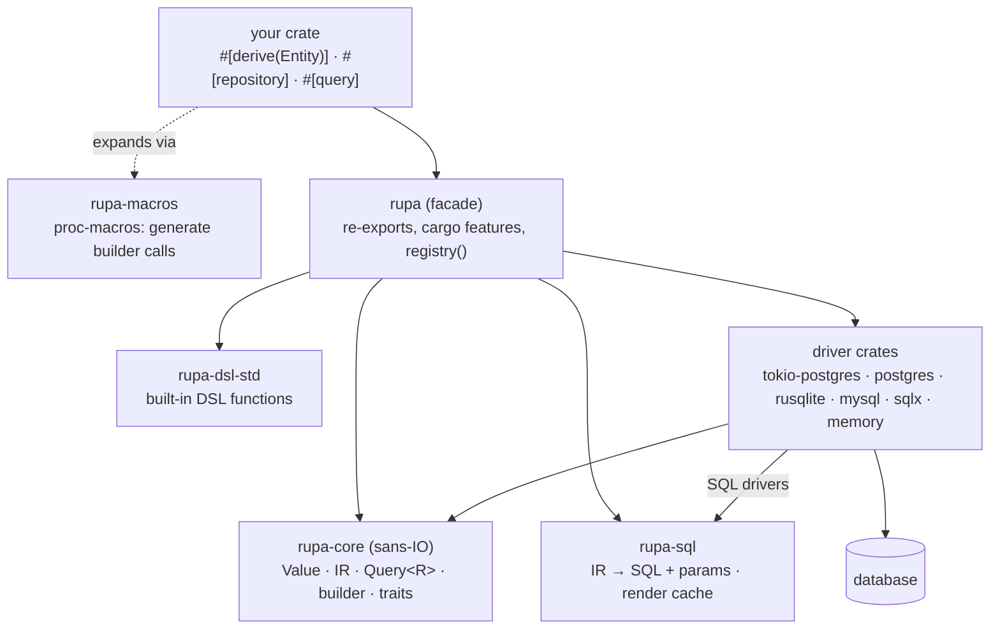
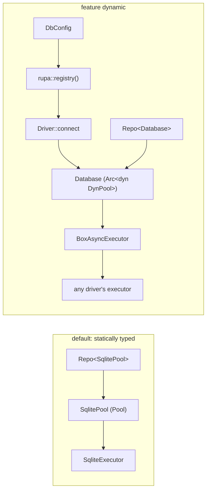

# Architecture: how a query flows

This is the map of the workspace: which crate owns what, and what happens,
file by file, between calling a repository method and getting rows back.

## Layers



- **`rupa-core`** never does IO. It defines the data (`Value`, the IR in
  `ir.rs`, `Query<R>`), the typed builder that produces it, and the traits a
  driver implements (`Executor`, `TxConnection`, `Pool` and their async
  twins).
- **`rupa-sql`** turns a `Statement` into SQL text plus bound parameters for
  one dialect. Only SQL drivers use it; the memory backend evaluates the IR
  directly.
- **Driver crates** run statements and decode rows. Each one is small:
  binding (`Value` → driver type), reading (driver row → `Value`), its error
  type (`rupa_sql::driver_error!`), and a pool.
- **`rupa`** is the facade. It owns the feature graph and, with `dynamic`,
  the registry of enabled drivers.

## One call, end to end

Take this repository, run on a SQLite pool:

```rust
#[repository]
pub trait Users: Send + Sync {
    #[query(filter = email == $email)]
    fn by_email(&self, email: &str) -> Result<Option<User>, rupa::DynError>;
}

let pool = SqlitePool::connect(&config)?;
let users = UsersRepo::new(&pool);
users.by_email("a@b.c")?;
```

### 1. Compile time: the macros write builder code

`#[derive(Entity)]` (`rupa-macros/src/entity.rs`) implements `Entity`
(table, ids and the constant `COLUMNS` metadata: kind, SQL type,
nullability, primary key, generation and foreign-key target) and `FromRow`
(decode by position) for `User`, plus one typed column handle constant per
field, such as `User::EMAIL: Column<User, String, Scalar>`. Each handle's kind
is selected at compile time from the field type
(`rupa-core/src/column/__private.rs`): scalar for `ScalarColumn` types,
nullable JSON for `Option` of a serde type, JSON for any other serde type.

`#[repository]` (`rupa-macros/src/repository.rs`) emits the trait and one
repository type, `UsersRepo<C>`, which holds a `Connection` `C`: here
`&SqlitePool`, but equally a single connection, a transaction, or an `Arc`,
`Box` or `Rc` of any of them. Two repositories share a transaction by holding
`&tx`. The query declarations select sync or async execution at compile time:
a sync repository runs on `Connection<Mode = Immediate>`, an async one on
every `Sync` connection, sync ones included. Repository traits are
dyn-compatible by default, with boxed async futures;
`#[repository(static_dispatch)]` opts into unboxed futures.

`Connection` (`rupa-core/src/connection.rs`) is implemented for every
transactional engine through its mode, never by drivers: `run` a statement and
`begin_tx` a transaction, both returning futures. A sync engine's futures are
`ready`, and `now` takes their value. Drivers implement the mode's own traits
through `&self` (`Executor`, `TxConnection`, `Transactional`, or their async
twins); a driver whose native API needs `&mut` serializes inside its executor.

For each method:

- `query::query_body` (`rupa-macros/src/query/mod.rs`) translates
  `#[query(filter = ..)]` into builder calls: `select::<User>().filter(..)
  .optional()`. The filter grammar is parsed by `dsl.rs` and turned into
  `Expr` code by `query/ctx.rs`. The result type (`Option<User>`) picks the
  terminal (`.optional()`) in `query/signature.rs`.
- The method runs the query on its connection. Execution errors pass through
  `DynError`; the declared error type only needs `From<DynError>`. Sync or
  async is decided by whether any method is `async`.

So the method body is roughly:

```rust
let __query = select::<User>().filter(User::EMAIL.eq(email)).optional();
now(complete(&self.0, __query)).map_err(|e| E::from(ExecError::into_dyn_error(e)))
```

### 2. Building: a `Query<R>` value, no IO

`select::<User>()` (`rupa-core/src/builder.rs`) starts an
`ir::Select` with the entity's table and projection. `User::EMAIL
.eq(email)` builds an `Expr<bool>` (`expr.rs`) whose node is
`ExprNode::Binary(Eq, Column(email), Param(Value::Text(..)))`. Values only
ever enter the IR as `ExprNode::Param`, so they are always bound, never
spliced into SQL.

`.optional()` finishes it as `Query<Option<User>>` (`query.rs`): the
statement plus `Expect::AtMostOne`, so the driver can stop after two rows.

### 3. Checking out a connection

`SqlitePool` implements `Pool`, and through `pool_executor!` the executor
traits, in `rupa_core::r2d2_pool!` (`rupa-core/src/pool/r2d2.rs`): its
`execute` checks out a `Pooled<r2d2::PooledConnection<..>>`, which forwards
`Executor` to the `SqliteExecutor` inside, runs the statement on it and
returns the connection to the pool when dropped.

### 4. Executing: render (cached), prepare (cached), run

`Query::execute` (`rupa-core/src/exec/engine.rs`) hands the query to the
engine's `Completion`, which calls the driver's `execute(statement, expect)`
and decodes the `Outcome`. Repository methods call `Connection::run` through
`complete` instead: a `static_dispatch` method's future stays unboxed, and a
dyn method boxes only its own future.
`SqliteExecutor::dispatch` (`rupa-driver-rusqlite/src/lib.rs`):

1. `clean()`: sends a rollback still owed by a transaction dropped earlier
   (see "Transactions").
2. `rupa_sql::render_cached(statement, dialect)`
   (`rupa-sql/src/cache/mod.rs`):
   - `cache/shape.rs` walks the statement once and produces its **shape**:
     a token stream of node kinds, identifiers (by `&'static str` address),
     and a bare "parameter" token per value. Values are never part of it.
   - The shape's hash picks one of 16 shards (`Mutex<hashlink::LruCache>`).
     On a hit, the cached SQL text (`Arc<str>`) is reused, and this call's
     values are bound through the entry's binding plan.
   - On a miss, `writer/` renders the SQL with the dialect's `Syntax`
     (`postgres.rs`, `mysql.rs`, `sqlite.rs`), recording which IR value
     feeds each placeholder. That record becomes the binding plan.
   - DSL calls are lowered (`cache/lower.rs`) before shaping, so the shape
     is that of the SQL actually rendered.
3. `conn.prepare_cached(&sql)`: rusqlite's own per-connection statement
   LRU. tokio-postgres keeps a `StatementCache` per connection
   (`rupa-driver-tokio-postgres/src/shared.rs`), sqlx and mysql their own.
4. Binds each `Value` through `value::Param` (text and blobs borrowed, not
   copied), runs, and buffers up to `expect.fetch_limit()` rows into a
   `RowCursor`.

### 5. Decoding: rows to `R`

`Outcome::decode` (`exec/mod.rs`) hands the cursor to
`<Option<User> as QueryResult>::from_output` (`query.rs`), which takes at
most one row, errors on a second (`ResultError::TooManyRows`), and calls
`User::from_row`. That reads each column by position as its `SqlType`
(`Row::get`), and the driver converts its own value into a `Value`
(`rupa-driver-rusqlite/src/value.rs`). Errors come back as the driver's
`SqliteError`, wrapped in `DynError`, then converted to the method's `E` by
`From<DynError>`.

## Static and dynamic



- **Static (default).** The repository is generic over the pool, so every
  call is monomorphized: no boxing, no dynamic dispatch per statement.
- **Dynamic (`dynamic`).** `rupa::connect(&config)` resolves a driver by
  name or URL scheme (`rupa-core/src/registry/mod.rs`) and returns a
  `Database`: an `Arc<dyn DynPool>` whose connections are
  `BoxAsyncExecutor`s (`erased/`). Errors are `DynError`. Sync drivers are
  served through `Blocking`. This path costs a box and a virtual call per
  statement (`docs/benchmarks.md`: about 0.3 µs on SQLite).

## Sync and async

Each runtime contract has a sync half and an async half behind the `async`
feature: `exec/`, `tx/`, `pool/`, `repo/` and `security/` each keep the
async half in an `asynchronous.rs` submodule. No runtime is involved until a
driver needs one: tokio-postgres and sqlx spawn on tokio, and the facade's
`tokio` feature only changes how a sync method of an async repository
blocks (`rupa/src/__macro_support.rs`).

`Blocking<E>` adapts a sync executor or pool to the async traits: futures
that are already complete. That is how async repositories run on SQLite
without a runtime.

## Transactions

`tx/mod.rs` holds the guard (`Tx<C>`) and the traits; drivers implement only
`TxConnection::control` (send `BEGIN`/`COMMIT`/`SAVEPOINT`, rendered by
`rupa_sql::render_tx`) and the dirty-connection bookkeeping:

- `begin()` on a transaction opens a savepoint (`depth + 1`).
- A sync `Tx` dropped while open rolls back in `Drop`.
- An `AsyncTx` can't await in `Drop`. It marks the connection dirty
  (`PendingRollback`), the driver sends the rollback before its next
  statement, and pools `clean()` connections when they come back.
- `begin_with_security` (`security/`) applies row-level-security settings
  inside the transaction. It only compiles for dialects with native RLS
  (`Supports<caps::NativeRls>`).

## Joins

`select::<A>().inner_join_on::<B>(|(a, b)| ..)` turns the builder into a
`JoinBuilder<(Src<A, 0>, Src<B, 1>), (A, B)>` (`join/build.rs`). Each source
is a handle that columns are taken through, so every column names its
source. Rows decode into tuples (`join/decode.rs`) or a `#[derive(Joined)]`
struct (`join/merged.rs`). Declared relations (`#[column(references = ..)]`)
let `join::<B>()` infer the condition (`join/relation.rs`).

## Where to look

| to change | look in |
|---|---|
| what a query can express | `rupa-core/src/ir.rs`, then `builder.rs` / `expr.rs` |
| the `#[query]` grammar | `rupa-macros/src/dsl.rs`, `query/attr.rs`, `query/ctx.rs` |
| the SQL a dialect gets | `rupa-sql/src/writer/` and `postgres.rs` / `mysql.rs` / `sqlite.rs` |
| caching | `rupa-sql/src/cache/`, `docs/design/caching.md` |
| a driver's value mapping | `<driver>/src/value.rs` (sqlx: `<db>/mod.rs`) |
| pools | `rupa-core/src/pool/` (traits and r2d2/deadpool glue), `<driver>/src/pool.rs` |
| configuration | `rupa-core/src/config/` |
| run-time driver selection | `rupa-core/src/registry/`, `rupa/src/registry.rs` |
| behaviour every backend must share | `rupa-conformance` |
